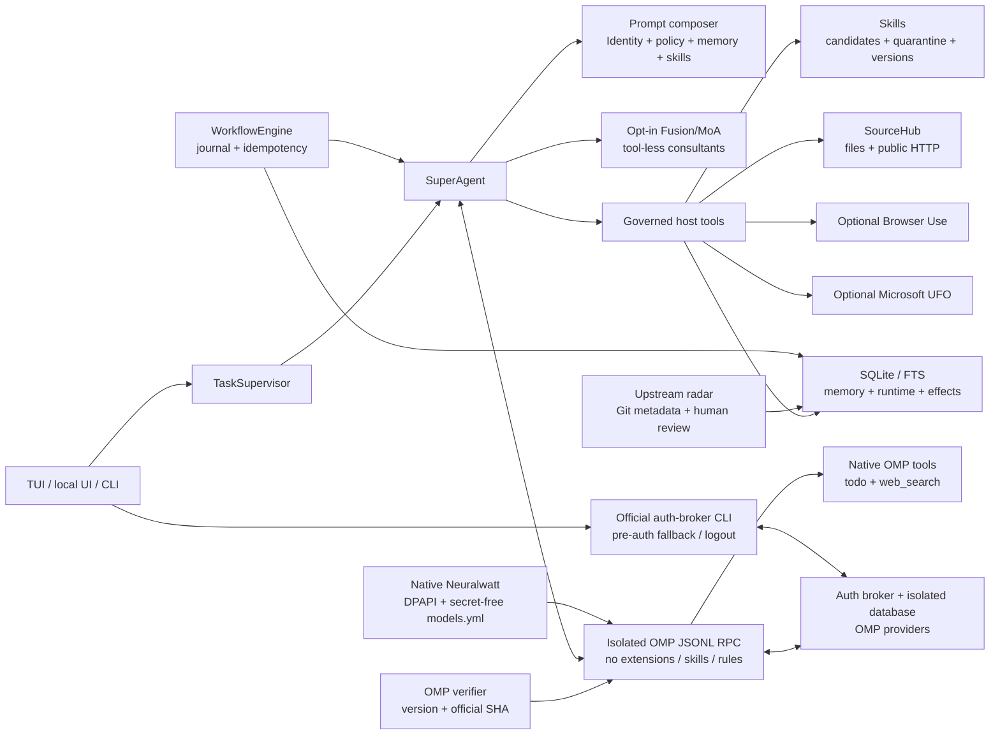

# Axiomux architecture

`SUPERAI` remains the internal compatibility namespace for environment variables, private state, and selected source identifiers.

## Principles

### OMP is a process dependency, not the product core

Axiomux uses the public JSONL RPC protocol to preserve OMP's strongest part: authentication broker, OAuth/device/API-key UI, provider storage/refresh, catalogue, model switching, and streaming. Capabilities with local access remain behind a dedicated host boundary.

It is not an OMP mod/fork and does not import its core. The dependency is an external executable managed project-locally and launched as a process; identity, UI, policy, tools, memory, tasks, Fusion, workflows, and learning belong to Axiomux. OMP extensions are neither required nor accepted.

The executable contract is `omp/17.0.4`, tag/commit `3fdd85ab6c6bab6c0cdee80abbbec0981740a5c0`. Before every spawn, `src/security/omp-runtime.ts` calculates SHA-256 and requires the official release digest for the audited platform/architecture combination. A mismatched version, digest, or platform fails closed; this detects binary replacement but does not turn an artifact without an Authenticode signature into an independent chain of trust.

`npm run omp:install` downloads the official asset to `.superai/bin/<release>-<asset>` with constrained host/HTTPS/size, an exclusive temporary file, digest verification before rename, and final validation. `ompExecutable: auto` prefers this project-local binary; external overrides remain subject to the same contract.

The Node runtime neither copies tokens nor imports OMP modules. In `strict` mode, every process receives:

- `HOME`, `USERPROFILE`, `APPDATA`, `LOCALAPPDATA`, `XDG_CONFIG_HOME`, and `PI_CODING_AGENT_DIR` inside `.superai/omp-runtime/`;
- a reduced process environment;
- `--no-session --no-extensions --no-skills --no-rules --no-pty`;
- only `todo` and `web_search` as native OMP tools for agent turns, or `--no-tools` for Fusion consultants.

Discovery/login against an empty database temporarily uses a fictitious credential-free local provider/model, sufficient for RPC readiness. The file is removed when the process exits; a later startup also removes only the exact marker left by a crash. It never appears in the operator-facing catalogue.

Login always begins over RPC. Only the known exact pre-auth rejection transfers control to `omp auth-broker login <provider>` in a real terminal, with fixed arguments, a strict environment, `PI_AUTH_NO_BORROW=1`, and the same isolated vault. Logout uses the equivalent official subcommand. These vault CLI processes are not coding-agent sessions and require no extensions. The UI does not yet expose the interactive path or multiple-account selection.

The global OMP database is invisible under strict isolation. Duplicate login is deliberate: it prevents global configuration, extensions, or credentials from becoming implicit dependencies. Tokens remain in OMP's private SQLite database under an ACL, without additional Axiomux encryption.

`shared` does not exist because it would break this boundary and silently make global HOME/configuration/discovered code part of the runtime. `yolo` does not exist because automatic approval would destroy the separation between proposal, authorization, and effect and make replay/fallback unsafe. The validator rejects both; neither is a hidden mode.

From OMP's evolution through `17.0.4`, Axiomux adopted only surfaces that reinforce its substrate role—registry/model metadata, authentication broker, device/OAuth flows, and the relevant RPC contract. OMP TUI/hub, advisor, prewalk, autolearn, browser/image/speech, and other product layers are ignored or disabled by the strict overlay because Axiomux already owns those responsibilities and must not duplicate authority.

### Local tools belong to Axiomux

`partitionOmpTools` rejects unknown native surfaces and replaces the `read`, `grep`, `glob`, `edit`, `write`, `bash`, and `python` capabilities with collision-free host tools: `workspace_read`, `workspace_grep`, `workspace_glob`, `workspace_edit`, `workspace_write`, `run_program`, and `run_python`. This is necessary because the audited OMP contract reserves built-in tool names even when those built-ins are disabled; a host tool may not safely override them. The host layer canonicalizes real paths, blocks private trees and Git metadata, limits content/results, and requires approval before mutations or process execution.

The `bash` and `python` capability labels remain only for configuration compatibility. Their model-facing tools are `run_program` and `run_python`: the former accepts an executable and arguments, rejects shells, and starts with `shell: false`; the latter runs with `-I`. The effect ledger is created before every consequential tool. These controls do not virtualize the operating system: approved programs retain the current account's privileges.

### Neuralwatt stays outside OMP executable discovery

`src/providers/neuralwatt.ts` implements login and catalogue discovery. The key is validated through `/v1/quota`; `/v1/models` is bounded, validated, and converted into a credential-free `.superai/omp-runtime/agent/models.yml`. The file refers only to `NEURALWATT_API_KEY`, injected into the child's environment. A managed catalogue without an available/decryptable key is a fail-closed error.

On Windows, the persisted key is a DPAPI `CurrentUser` envelope. The complete `login` plus catalogue-generation flow is Windows-only in `0.1.0`; on other platforms, an ephemeral environment variable requires separately provisioned `models.yml`. There is no executable Neuralwatt extension and no need to enable extension discovery.

For routing, Neuralwatt enters the same `provider/model` catalogue, CLI/UI selectors, and Fusion/MoA panels. Its implementation difference—a native adapter and DPAPI—does not create a second provider UX.

### Personality is content; policy is authority

`agent/IDENTITY.md`, `SOUL.md`, and `persona.md` control identity and voice. `agent/USER.md` is only a public template; approved preferences live in `.superai/user.md` or governed memory. `AGENTS.md`, `TOOLS.md`, and `MEMORY_POLICY.md` control behavior and boundaries. The Axiomux identity is original: direct, incisive, and dryly humorous, without imitating third-party characters.

Configurable intensity `0–3` is read dynamically while composing each turn: `0` is nearly neutral and `3` is more pronounced. Changing it does not restart the process or alter tools, approvals, evidence, or authority.

The composer keeps separate:

- stable operator/project instructions;
- approved memories that may carry authority;
- retrieved/pending evidence marked as untrusted;
- active skills and available tools.

### Offline hybrid memory, with honest limits

`MemoryStore` retains messages, memory items, sources/chunks, recall logs, feedback, relations, and learning candidates in SQLite. FTS5 provides lexical retrieval. A deterministic feature-hashing vector adds token, approximate-stem, and n-gram signals; RRF combines rankings and MMR reduces redundancy. The final score includes recency, confidence, importance, review state, authorship, use, and feedback.

This vector is not a learned semantic embedding. It is fast, offline, and reproducible, but offers weaker conceptual retrieval when two texts use very different vocabulary.

Memories expire, may be superseded, have scopes, and preserve provenance. Contradiction suggestions are only review candidates; explicit relations remain human decisions.

`SourceHub` is deliberately narrow: files inside the workspace and public HTTP/HTTPS subject to SSRF validation, limits, chunking, and provenance. It does not attempt to reproduce OB1 or Dify's SaaS/enterprise connector breadth; every future connector needs its own authentication, license, and threat model.

### Learning is governed in two phases

The runtime may create a learning candidate when an outcome appears reusable; this classification is heuristic, not evidence of recurrence. A person must approve the candidate before conversion to `SKILL.md`. The converted skill remains in private quarantine under `.superai/skills/`, passes through the scanner, and requires another approval for activation. The manual `/learn` command is an explicit shortcut for creating an already-quarantined proposal and retains final approval.

Previous versions are archived by hash. Evaluations, rollback, and governance export make evolution auditable. A skill does not auto-execute scripts; separately, the Python host tool may execute approved code without an OS sandbox and therefore remains a high-risk boundary.

### Self-evaluation records operation, not truth

After a task, the runtime may store a `pending` memory containing bounded operational metadata: status, duration/counts, and observed failures. The record has a TTL, task-level idempotency, and no complete prompt/response. It does not assess factual accuracy, gain authority automatically, or enter approved memory without human review.

### Fusion is advisory

`FusionEngine` starts two or more consultants concurrently with a semaphore, per-candidate timeout, `Promise.allSettled`, and deterministic ordering. Consultants:

- receive only the current request, not private memory;
- run without tools, extensions, skills, or rules;
- return sanitized text as untrusted data.

In `fusion` mode, a second tool-less turn synthesizes the panel. In `moa`, the panel goes directly to the primary agent. In both modes, only the primary agent may use tools and produce effects. The mode is opt-in because it replicates data, cost, and latency across providers.

### Effects precede fallback

Before executing an effectful host tool, the runtime writes an effect-ledger record. Fallback is permitted only when no consequential approval/effect has occurred. A provider failure after a write, ingestion, or external action therefore cannot trigger silent replay through another model.

Provider health/circuit state is persisted to avoid immediate repeated calls to failing backends. This improves availability but does not turn remote calls into distributed transactions.

Cross-provider fallback is empty by default and accepts up to 8 validated routes when configured. A model preference stored in a session is exact routing and is not converted into the global fallback list. If that model fails, the session fails visibly rather than silently sending the request to another provider.

Fusion/MoA accepts 2–8 arbitrary models from the unified catalogue, an optional synthesizer, and concurrency limited to 8. CLI and the **Routing** UI dialog update the same configuration; requests with explicit per-session/request routing activate neither fallback nor Fusion fan-out.

### Steering is part of the runtime

`TaskSupervisor` retains queued/running/completed/failed/cancelled tasks, enforces one active task per project, and accepts input while a turn runs:

- ordinary text steers the active task;
- `/next` creates a real follow-up task in the same session;
- `/stop` triggers explicit cancellation;
- “do not stop” is not classified as a stop request.

Messages, tasks, and public events remain persistent. OMP receives steering once a turn is active; early messages are stored and integrated before the primary prompt. After restart, history remains visible, but queued/running/waiting tasks are reconciled as interrupted; model or tool execution never resumes automatically.

### Multi-project is a boundary, not merely a label

The runtime persists canonical roots, binds every session/task to one project, and enforces single-flight per project. Agent, SourceHub, and workspace-tool contexts are built for the selected root; global search is read-only, bounded, and exposed only through explicit global TUI action. Removing a project only unlinks it from the catalogue and never silently deletes history.

The alpha E2E test uses two workspaces and confirms distinct current directories, one central vault, correct session/UI routing, isolated project/global memory, blocked host escape, and cross-project concurrency. The boundary is complete for `0.1.0-alpha`; it is not intended as security isolation between users.

### The local UI is a narrow boundary

`src/ui/server.ts` uses loopback HTTP only. A one-time bootstrap creates an HttpOnly cookie; every mutation requires a valid session and exact Origin. Host/proxy headers, CORS, content types, and sizes are restricted. SSE events pass through a public projection that removes credentials and private reasoning.

The UI is a local interface, not a multi-user server or remote API. English is the default locale; the EN/PT selector localizes the web resources and sends a bounded `responseLanguage` preference with each new chat request. `TaskSupervisor` carries that preference to the principal agent and any follow-up, while Fusion/MoA propagates it to every tool-less consultant and optional synthesizer. A trusted model-side presentation instruction requests English or European Portuguese prose while preserving code, commands, paths, logs, errors, quotations, source excerpts, data values, and exact tokens. There is no client-side translation or history rewriting, and an explicit user language request wins for that turn. CLI/TUI/API diagnostics and persisted authority remain English.

### The upstream radar is triage, not an updater

`UpstreamManager` reads baselines and filters from `config/upstreams.json`, queries GitHub release/commit/tree metadata, and persists checks/reviews in `.superai/upstream-radar.json`. It compares only identity, SHAs, relevant paths/hashes, and messages; it requests no blobs/patches, does not clone or execute anything, and changes neither code nor baselines.

`list`, `check`, `show`, and `mark` separate detection from decisions. Include/exclude/topic filters ignore the rest; `pending|reviewed|dismissed` is a human mark, not automatic adoption. Every selected mechanism still requires source/license review, explicit implementation, tests, and a manual baseline update.

### Adapters remain outside the sandbox

`CommandAdapter` starts processes without a shell, sends JSON over stdin, constrains time/output, applies an environment allowlist, and terminates the process tree when necessary. Agent use requires approval.

Browser Use adds an ephemeral profile/download directory, a domain allowlist, and IP blocking. The task, page state, and potentially screenshots/vision are sent to the adapter's own cloud LLM in addition to the primary provider. UFO requires an external checkout. These measures limit the surface, but both processes remain native user code and should run in a controlled VM/profile.

### Workflows treat crashes as ambiguous states

Every workflow is bound to the definition's canonical hash. Before an effectful step, the engine persists a `started` entry with a stable idempotency key. After restart:

- a changed definition is rejected;
- completed steps are not repeated;
- an interrupted agent step after `started` pauses as an unknown effect;
- retry, complete, or fail requires explicit operator resolution.

This reduces accidental duplication. The end-to-end guarantee also depends on the downstream integration honoring the idempotency key.

## Main modules

| Module | Responsibility |
|---|---|
| `src/rpc/omp-client.ts` | RPC lifecycle, login UI, catalogue, streaming, steering, host tools, and flag-based isolation |
| `src/security/omp-runtime.ts` | exact contract and official SHA-256 verification before every OMP spawn |
| `scripts/install-omp.ts` | bounded, verified, atomic project-local installation of the audited OMP release |
| `src/security/omp-isolation.ts` | isolated directories and rejection of implicit executable surfaces |
| `src/providers.ts` | aliases and union of per-provider login/models/status |
| `src/providers/omp-auth-broker.ts` | official terminal CLI login/logout fallback in the isolated vault |
| `src/providers/neuralwatt.ts` | Neuralwatt login, catalogue, and credential-free models.yml |
| `src/security/secret-vault.ts` | fail-closed DPAPI storage on Windows |
| `src/agent.ts` | turn composition, recall, tools, Fusion, effects, and fallback |
| `src/tools/workspace-tools.ts` | workspace/process host tools, limits, approval, and path boundary |
| `src/runtime/store.ts` | projects, sessions, tasks, events, steering, effects, and provider health |
| `src/runtime/project-boundary.ts` | canonical roots and rejection of projects crossing private state/installation |
| `src/runtime/supervisor.ts` | TUI/UI concurrency, steering, follow-up, and stop |
| `src/fusion/*` | consultant panel and tool-less synthesis |
| `src/upstreams/manager.ts` | Git metadata-only radar, baselines, filters, and human review |
| `src/memory/store.ts` | SQLite/FTS, hybrid retrieval, lifecycle, sources, and learning candidates |
| `src/memory/vector.ts` | deterministic offline feature-hash vector |
| `src/skills/*` | discovery, scanner, quarantine, reviews, versions, evaluations, and rollback |
| `src/workflow.ts` | definition hash, journal, idempotency, retry, and recovery |
| `src/sources.ts` | file/URL ingestion with provenance and SSRF/path/body controls |
| `src/ui/server.ts` | authenticated loopback server, local API, and sanitized SSE |
| `src/adapters/command-adapter.ts` | shell-free JSON processes, limits, cancellation, and environment allowlist |
